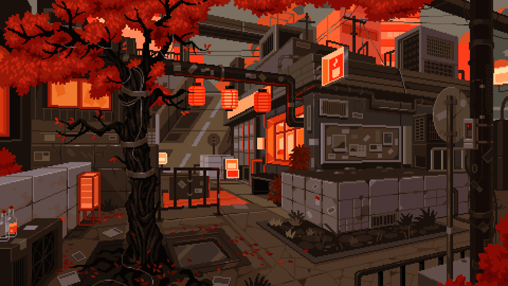

 

*Building digital things by day, fictional universes by absolutely no reasonable schedule.*

**Too many ideas. One keyboard. An unreasonable amount of ambition.**

 

 

*“Somewhere between a good idea and seeing where it goes.”*

- 💻 Building things for the web
- ⚡ JavaScript, React and Next.js
- 🧠 Curious about how things work under the hood
- 🇯🇵 Currently practising for **JLPT N4**
- ☕ Too many ideas, not enough open tabs

 

## The tools in my corner

<table>
<tr>
<td><b>Programming Languages</b></td>
<td></td>
</tr>
<tr>
<td><b>Frontend</b></td>
<td></td>
</tr>
<tr>
<td><b>Backend & APIs</b></td>
<td>  </td>
</tr>
<tr>
<td><b>Databases & ORM</b></td>
<td></td>
</tr>
<tr>
<td><b>Authentication & Validation</b></td>
<td>  </td>
</tr>
<tr>
<td><b>Developer Tools</b></td>
<td></td>
</tr>
<tr>
<td><b>Deployment</b></td>
<td> </td>
</tr>
<tr>
<td><b>External Services</b></td>
<td> </td>
</tr>
</table>

## Find Me Elsewhere

Thanks for stopping by. Try not to open another tab. ✦

